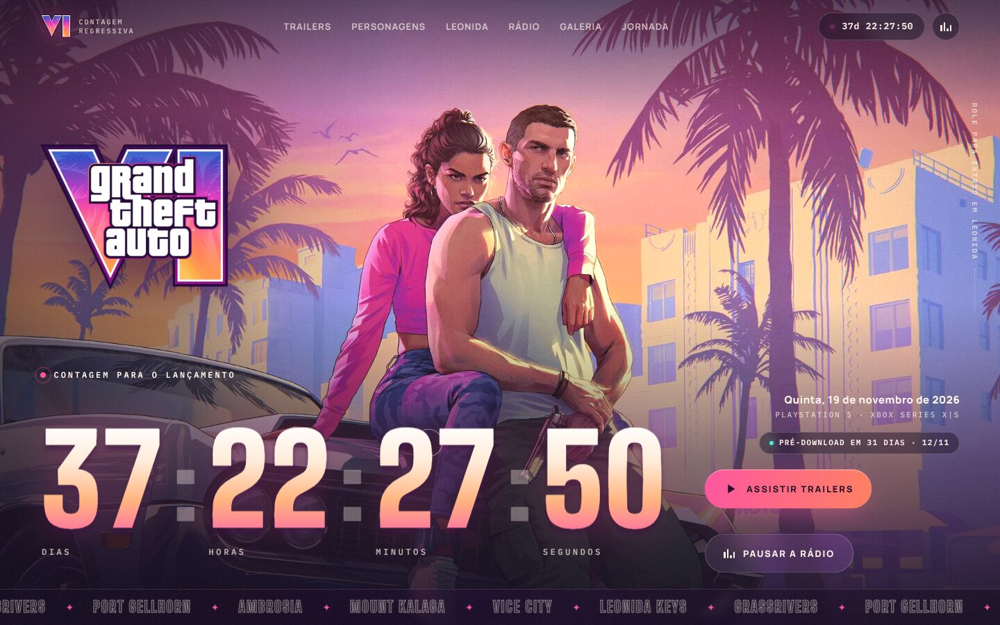
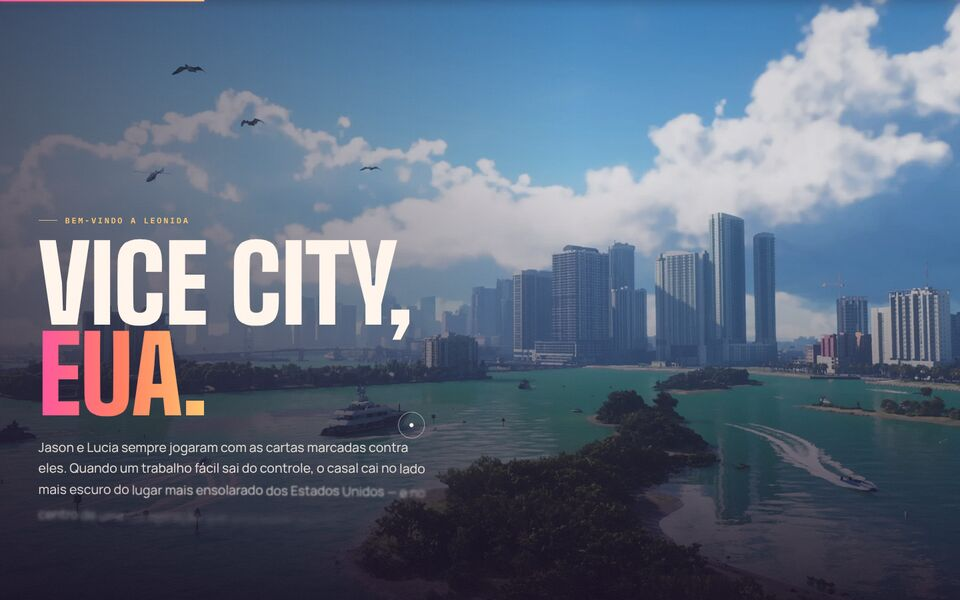
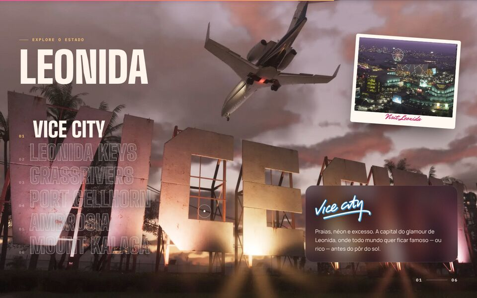
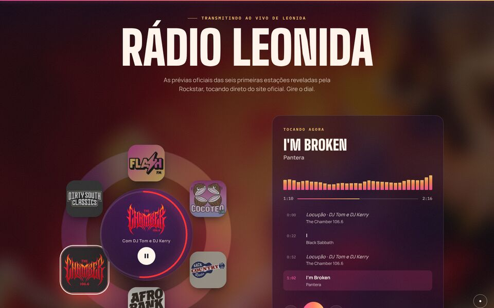
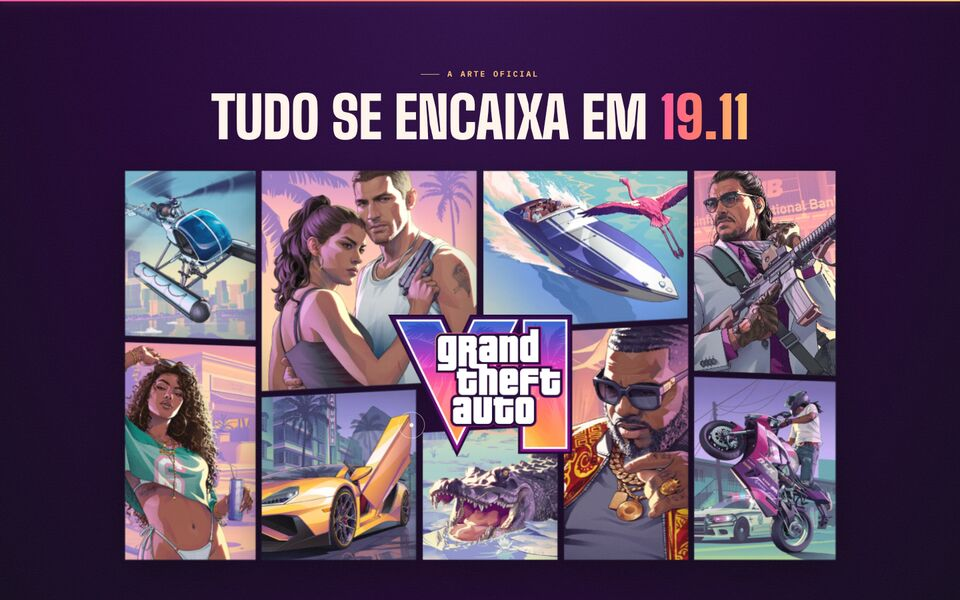
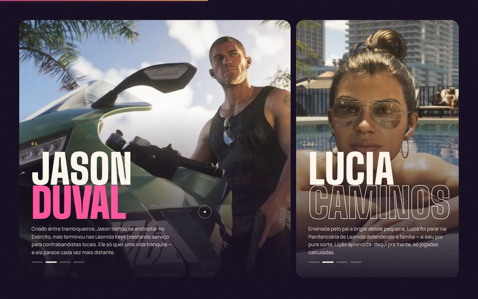
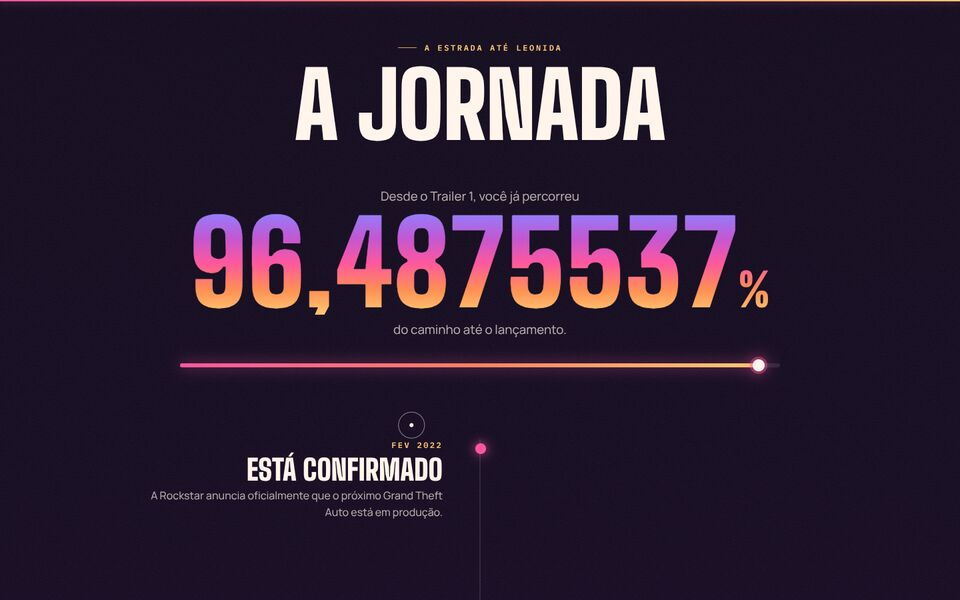
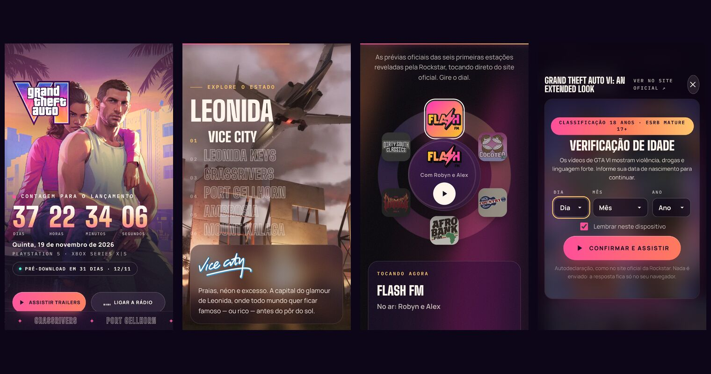
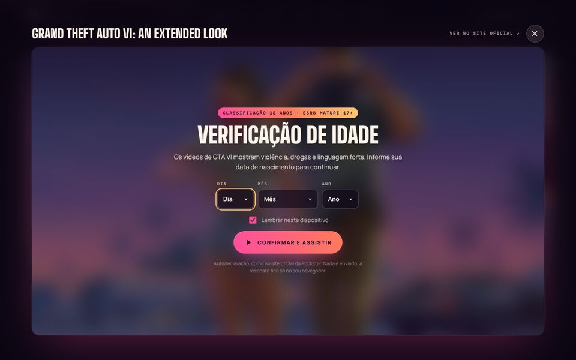

<div align="center">

# GTA VI — Contagem Regressiva

**Uma contagem regressiva cinematográfica, feita por fã, para o lançamento de
Grand Theft Auto VI em 19 de novembro de 2026.**

[**▶ Ver ao vivo**](https://matheusaoliv.github.io/gta-6/) ·
[Recursos](#o-que-tem-no-site) ·
[Vídeos e idade](#vídeos-dentro-do-site-com-verificação-de-idade) ·
[Rádio](#rádio-leonida) ·
[Rodar localmente](#como-rodar)




</div>

Inspirado no [site oficial](https://www.rockstargames.com/VI), o projeto tenta
ir além dele em movimento e interatividade: arte em WebGL, o logo "VI" virando
portal, rádio do jogo tocando de verdade e o *An Extended Look* passando dentro
da página, junto com os trailers 1 e 2.

> **Projeto não oficial e sem fins lucrativos.** Não é afiliado à Rockstar Games
> nem à Take-Two Interactive. Todo o conteúdo do jogo pertence aos seus donos.

---

## O que tem no site

| | |
|---|---|
|  | **Mergulho pelo VI.** O logo vira uma janela recortada sobre Vice City e cresce com o scroll até a imagem tomar a tela inteira. É a assinatura do site oficial, reimaginada. |
|  | **Leonida.** As 6 regiões (Vice City, Leonida Keys, Grassrivers, Port Gellhorn, Ambrosia e Mount Kalaga) trocam com o scroll, com transição em máscara, logos oficiais e um cartão-postal que gira. |
|  | **Rádio Leonida.** Um dial no estilo do jogo com as 6 prévias oficiais das rádios. A lista de faixas é sincronizada, há o aviso de troca de estação igual ao do GTA, chiado de sintonia e um visualizador que reage à música. |
|  | **A capa se monta.** Os 10 painéis da arte oficial voam em 3D e se encaixam com o scroll. |
|  | **Jason & Lucia e o elenco.** Painéis que se expandem no hover, galerias automáticas e o elenco de apoio em scroll horizontal, com as ilustrações oficiais em camadas. |
|  | **A jornada.** Mostra, com 7 casas decimais, quanto da espera desde o Trailer 1 já passou, mais uma linha do tempo com o marcador "você está aqui". |

Também tem:

- **Entrada:** portão de som, onde você escolhe entrar com ou sem trilha, e um mergulho pelo "I" do logo.
- **Contagem:** dígitos que giram como num caça-níquel, e a contagem acompanha você no menu e no título da aba.
- **Trailers:** os três vídeos oficiais tocam num player próprio, dentro de um modal. A rádio pausa sozinha e volta quando você fecha.
- **Galeria:** 24 capturas oficiais em esteiras infinitas que reagem ao scroll, com arraste e lightbox (teclado e swipe).
- **Agenda e compartilhamento:** um botão baixa um arquivo `.ics` com o pré-download (12/11) e o lançamento (19/11), e outro compartilha a contagem.
- **Detalhes:** player fixo da rádio, cursor personalizado, botões magnéticos e grão de filme.

<div align="center">



*Tudo funciona no celular, inclusive o player e a rádio.*

</div>

---

## Vídeos dentro do site, com verificação de idade



Antes do primeiro vídeo, o site pede a **data de nascimento** e só libera para
quem tem 18 anos ou mais (classificação indicativa no Brasil; ESRB Mature 17+).

- **Como funciona:** é uma autodeclaração, igual à do site da Rockstar. A
  resposta fica só no navegador (`localStorage`, se você marcar "lembrar"). Quem
  informa menos de 18 anos fica bloqueado na sessão.
- **Por que não usar o player do YouTube:** os vídeos de GTA VI estão
  bloqueados para reprodução fora do YouTube (erro 150 do player), e a
  verificação de idade de lá depende da conta logada. Por isso os vídeos tocam
  num player próprio.

O que acontece com cada vídeo:

| Vídeo | Onde toca | Por quê |
|---|---|---|
| **An Extended Look** | **Dentro do site**, no player próprio | A Rockstar publica o vídeo em MP4 (H.264) no CDN de vídeo dela, em 360p, 720p, 1080p e 4K, com **legendas oficiais em português**. O player transmite direto de lá. |
| **Trailer 1** e **Trailer 2** | **Dentro do site**, no player próprio | A Rockstar só oferece esses trailers como download 4K em MPEG-4 Part 2, codec que nenhum navegador reproduz. Eles foram convertidos para H.264 1080p (cerca de 3,7 Mbps, com `faststart` para começar a tocar antes de baixar tudo) e ficam em [`assets/video/`](assets/video/): 41 MB e 78 MB. |

Para refazer a conversão a partir dos arquivos oficiais:

```bash
for n in 1 2; do
  ffmpeg -i "https://media-rockstargames-com.akamaized.net/VI/downloads/videos/GTAVI_Trailer_$n/GTAVI_Trailer_$n.mp4" \
    -map 0:v:0 -map 0:a:0 -vf "scale=1920:1080:flags=lanczos,format=yuv420p" \
    -c:v libx264 -preset slow -crf 21 -maxrate 4000k -bufsize 8000k -profile:v high -level 4.1 -g 60 \
    -c:a aac -b:a 160k -ac 2 -map_metadata -1 -write_tmcd 0 -movflags +faststart \
    "assets/video/gtavi-trailer-$n-1080p.mp4"
done
```

O player próprio tem:

- Seletor de qualidade de 360p a 4K no An Extended Look, que lembra sua escolha.
- Legendas em pt-BR, inglês e espanhol, com as falas em português já ligadas.
- Opção de continuar de onde você parou.
- Picture-in-picture e tela cheia.
- Atalhos de teclado:

  | Tecla | Ação |
  |---|---|
  | `Espaço` ou `K` | tocar/pausar |
  | `←` `→` | 5 s |
  | `J` `L` | 10 s |
  | `↑` `↓` | volume |
  | `M` | mudo |
  | `C` | legendas |
  | `F` | tela cheia |
  | `0`–`9` | pular para 0–90% do vídeo |

---

## Rádio Leonida

As prévias das rádios são as **oficiais**, publicadas pela Rockstar em
08/10/2026 em [rockstargames.com/VI/music](https://www.rockstargames.com/VI/music).
O áudio é transmitido direto de lá, sem cópias neste repositório.

| Estação | Gênero | Apresentadores |
|---|---|---|
| Flash FM | Pop | Robyn e Alex |
| Cocoteo FM | Latina moderna | El Martillo e La Gata |
| Back Country Radio | Country | MW e Delta Dawne |
| AfroBank FM | Amapiano e clássicos africanos | Burna e Palmsy |
| The Chamber 106.6 | Metal | DJ Tom e DJ Kerry |
| Dirty South Classics | Rap clássico do Sul | Trick e Trina |

Como o site oficial não libera CORS, o navegador não deixa analisar o áudio em
tempo real. Para o visualizador reagir à música mesmo assim, o
[`radio-levels.js`](assets/js/radio-levels.js) guarda a energia de cada prévia
em 4 bandas de frequência, 20 vezes por segundo, calculada antes e sincronizada
com o tempo da faixa.

---

## Como rodar

O site é 100% estático: HTML, CSS e JavaScript puro, sem build nem dependências
para instalar. Os vídeos precisam de uma origem `http(s)`, então sirva a pasta
com qualquer servidor estático:

```bash
git clone https://github.com/matheusaoliv/gta-6.git
cd gta-6
npx http-server . -p 8080 -c-1     # ou: python3 -m http.server 8080
```

Depois abra `http://localhost:8080`.

### Publicação

O site publicado sai da branch **`gh-pages`** via GitHub Pages. Para atualizar,
envie o conteúdo para essa branch:

```bash
git push origin HEAD:gh-pages
```

O GitHub reconstrói o site em menos de um minuto. As tags `og:url` e
`og:image` do `index.html` apontam para `https://matheusaoliv.github.io/gta-6/`;
se publicar em outro endereço, ajuste essas duas tags.

### Personalizar

Quase todo o conteúdo editável está em [`assets/js/data.js`](assets/js/data.js):

- **Datas:** `release` (padrão: meia-noite de 19/11/2026 no fuso do visitante,
  porque o horário oficial de liberação ainda não foi anunciado), `preload` e
  `trailer1`.
- **Rádios:** `stations`, com a URL de cada prévia e os tempos das faixas.
- **Vídeos:** `videos`, com as fontes por qualidade, legendas e links.
- **Lugares:** `places`, com os textos das regiões.

---

## Por dentro

```
index.html                 # estrutura e conteúdo das seções
assets/
  css/main.css             # tokens de design, layout e componentes
  js/data.js               # datas, rádios, vídeos e lugares
  js/main.js               # contagem, scroll (Lenis + ScrollTrigger), seções, modais, cursor
  js/player.js             # verificação de idade e player de vídeo
  js/radio.js              # rádio, HUD, visualizador e Media Session
  js/radio-levels.js       # energia pré-calculada das prévias (4 bandas, 20 fps)
  js/webgl.js              # shader do hero (dissolve, miragem, aberração cromática, grão)
  js/vendor/               # GSAP 3.15 (ScrollTrigger, SplitText, CustomEase) e Lenis 1.3
  fonts/                   # Big Shoulders Display, Manrope, Mr Dafoe e IBM Plex Mono (OFL)
  img/                     # artes e capturas oficiais otimizadas em WebP (~11 MB)
  video/                   # trailers 1 e 2 convertidos para H.264 1080p
docs/                      # imagens deste README
```

### Movimento

- **Scroll:** suave com Lenis, sincronizado ao ScrollTrigger.
- **Seções fixadas com scrub:** o mergulho pelo VI, o elenco em scroll horizontal, as regiões de Leonida e a capa se montando.
- **Textos:** revelados com SplitText, usando máscara por linha.
- **Hero:** shader WebGL próprio, que pausa quando sai da tela ou quando a aba fica oculta.

### Acessibilidade

- Com `prefers-reduced-motion` ligado, o site desativa o scroll suave, os pins, o WebGL e as animações longas.
- Os diálogos fecham com `Esc` e prendem o foco, o dial da rádio funciona com setas, e as imagens têm textos alternativos em português.
- A contagem é anunciada por um `role="timer"` só para leitores de tela, atualizado a cada minuto.

### Desempenho

- Imagens em WebP com `width`/`height` e carregamento preguiçoso.
- Fontes auto-hospedadas com `preload`.
- A entrada não trava: o shader é compilado e a imagem do hero é decodificada (com `createImageBitmap`, fora da thread principal) enquanto o portão de som ainda está na tela. No clique, só sobra animação de `transform` e `opacity`.
- O shader tem teto de densidade e de pixels totais (menor no celular), e o visualizador da rádio e as esteiras da galeria param quando saem da tela.
- Nada de vidro desfocado (`backdrop-filter`) por cima do canvas animado, e o grão de filme fica parado no celular.
- Os vídeos só baixam quando você dá play (`preload="metadata"`), e as rádios tocam direto do servidor oficial.

---

## Créditos e aviso legal

- **Conteúdo do jogo:** Grand Theft Auto VI, logotipos, artes, capturas,
  trailers e prévias de rádio são © Rockstar Games / Take-Two Interactive e
  seus licenciadores. Eles são usados aqui sem fins lucrativos, como homenagem
  de fã.
- **Vídeos:** o An Extended Look é transmitido do CDN oficial da Rockstar; os
  trailers 1 e 2 são os downloads oficiais da Rockstar, apenas convertidos de
  formato para tocar no navegador.
- **Bibliotecas:** [GSAP](https://gsap.com) (licença padrão "no charge") e
  [Lenis](https://github.com/darkroomengineering/lenis) (MIT).
- **Fontes:** Big Shoulders Display, Manrope, Mr Dafoe e IBM Plex Mono, todas
  sob a SIL Open Font License, via Fontsource.
